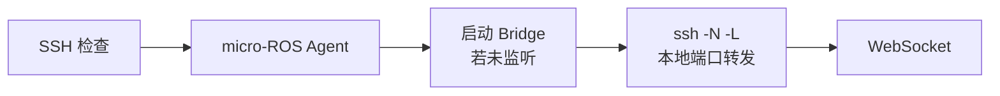
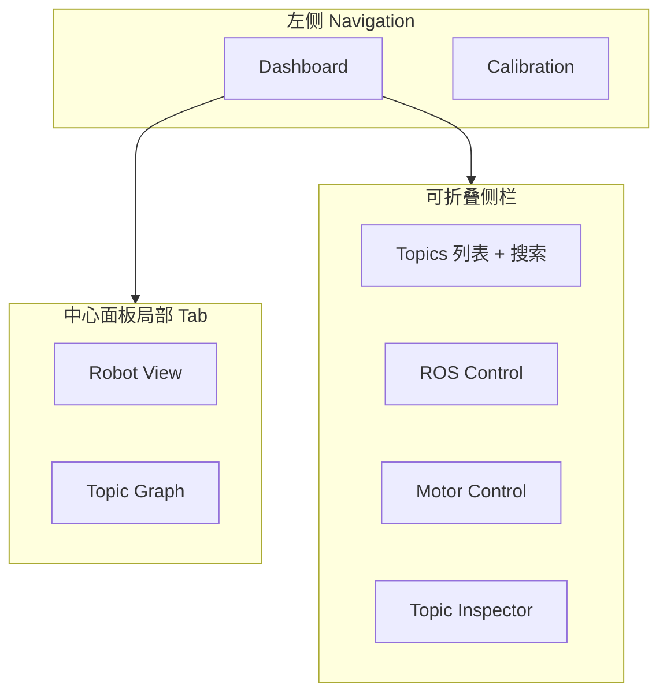
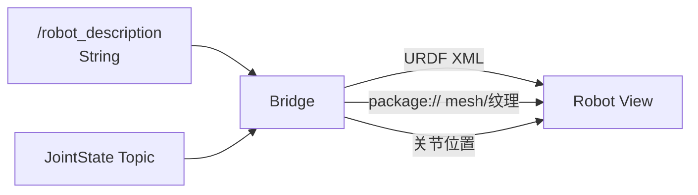
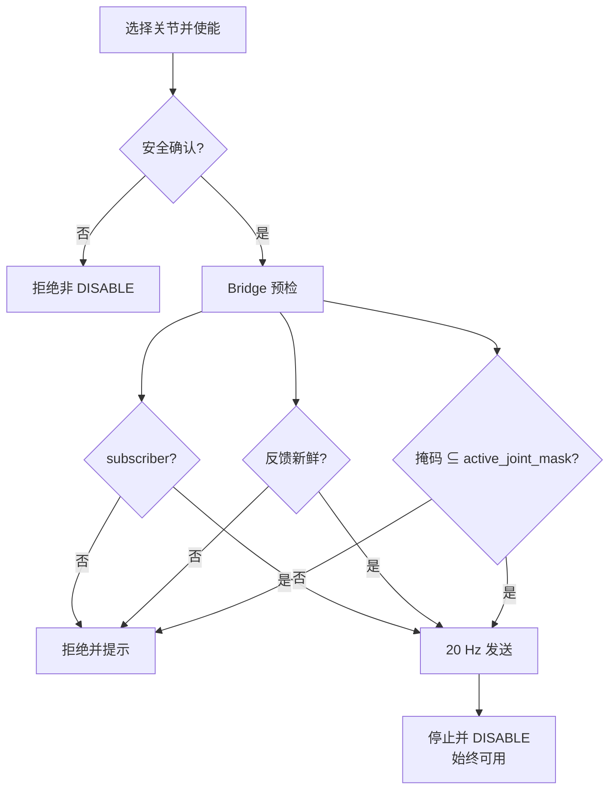
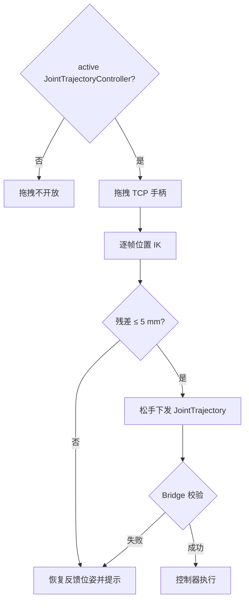
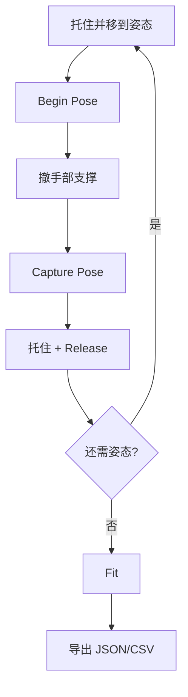
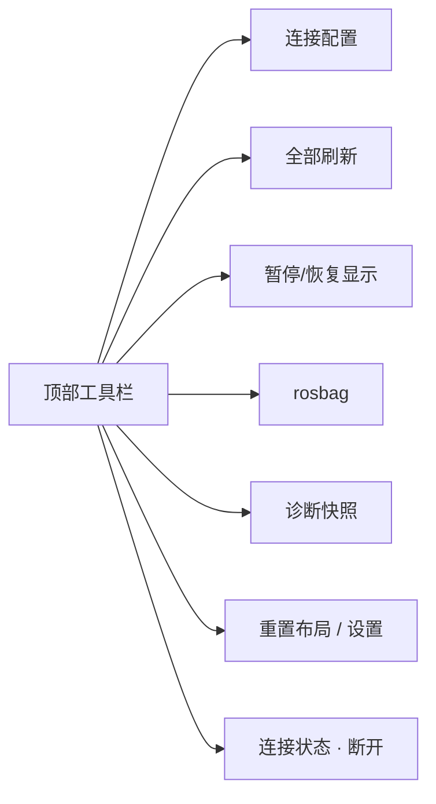

# 功能概览

本文按模块说明 **Robot Debug Desk** 已实现能力：每块写清做什么、怎么用、以及安全/边界注意。行为细节与单元测试矩阵见 [基本功能与测试覆盖](./basic-features)；连接链路补充见 [连接与 Bridge](./connect)；协议字段见 [Bridge 协议](./protocol)。

## 目录

1. [连接与会话](#_1-连接与会话)
2. [Topics / Graph / Inspector](#_2-topics-graph-inspector)
3. [Robot View（URDF）](#_3-robot-view-urdf)
4. [MIT 电机控制](#_4-mit-电机控制)
5. [TCP 拖拽轨迹](#_5-tcp-拖拽轨迹)
6. [Joint4 标定](#_6-joint4-标定)
7. [工具栏：rosbag / 诊断 / 布局](#_7-工具栏-rosbag-诊断-布局)

---

## 1. 连接与会话

### 做什么

桌面端不加入 DDS。会话经 SSH 隧道访问 Jetson 上只监听 `127.0.0.1` 的 WebSocket Bridge，并在连接后轮询 micro-ROS Agent 状态。

### 怎么用

1. 打开连接配置（首次启动或工具栏「连接配置」），填写 Profile：SSH 主机 / 用户 / 端口 / 私钥、ROS Domain、ROS 环境脚本（`install/setup.bash`）、URDF / JointState 等 Topic。
2. 点击连接。界面按阶段推进并展示失败原因：
3. 连接成功后，工具栏右侧显示连接名、实际隧道端口、Agent 状态；可随时断开。
4. 连接中可再次打开配置并保存——**保存不会中断当前会话**，新值在下次重连时生效。

默认 Profile 示例（可按机器修改）：

```text
SSH host: jetson
ROS setup: leader_follower/install/setup.bash   # 相对远端 $HOME，或绝对路径
Remote port: 8765
Local port: 18765
URDF topic: /robot_description
JointState topic: /stm32/joint_states
```



### 注意与边界

- Bridge **只监听** Jetson `127.0.0.1:8765`，不应直接开放到局域网。
- 首选本地端口被占用时自动选空闲端口，界面显示**实际**转发端口，不要假定一定是 `18765`。
- ROS 环境脚本路径只允许 `[A-Za-z0-9._-/]`，拒绝 `~`、`.`/`..`、空段和以 `-` 开头的段。
- 旧配置会自动迁移（例如旧 setup 路径、旧 `/joint_states` → `/stm32/joint_states`）。
- **断开**时关闭 WebSocket 与 SSH 隧道；若电机命令流在运行，先请求 DISABLE。
- **断开 / 重连**清空上一会话的 Topic、采样、URDF、JointState、控制器与硬件状态、错误与未完成请求；**保留**连接配置与布局偏好。旧 WebSocket 延迟帧不会污染新会话。
- Agent：连接后每 5 秒检查 `micro-ros-agent-stm32h723.service`，区分运行中 / 未运行 / 检查失败。

更多说明：[连接与 Bridge](./connect)。

---

## 2. Topics / Graph / Inspector

### 做什么

浏览 ROS graph 中的 Topic，只读订阅并查看消息；用 Topic Graph 看 Publisher / Subscriber 拓扑；在 Topic Inspector 里用本机 jq 过滤，并对 `sensor_msgs/msg/Image` 做 Canvas 预览。侧栏还可查看 `/controller_manager` 并 Activate / Deactivate。

### 界面结构



### 怎么用

**Topics 浏览**

1. 连接成功后，Topics 列表从 ROS graph 拉取名称与类型（默认约 30 秒自动刷新，也可点标题栏刷新；周期可在设置中改为 5–300 秒）。
2. 用列表头部搜索框按名称或类型过滤（大小写不敏感）；过滤只影响显示，不改订阅。
3. 点击 Topic 创建只读订阅，查看最新 JSON、累计消息数与平均频率。

**Topic Graph**

1. 在中心面板切到「Topic Graph」Tab；打开时立即加载，默认每 30 秒刷新，也可点「刷新 Graph」。
2. 布局近似 `rqt_graph`：Publisher 偏左、Topic 居中、Subscriber 偏右（Sugiyama 分层 + 重心排序减交叉）。
3. 点击节点高亮一跳关联；点击 Topic 节点会订阅该 Topic，并送入右侧 Topic Inspector。

**Topic Inspector / jq / 图像**

1. 在 Inspector 查看当前选中 Topic 的数据。
2. 需要过滤时填写 jq 表达式（按 Topic 持久化；默认留空则显示原始 JSON）。使用浏览器内嵌 jq 1.8.2 WASM，不依赖 Jetson 安装 jq。
3. 对 `sensor_msgs/msg/Image`：数据 Tab 用 Canvas 实时预览（rgb8 / bgr8 / rgba8 / bgra8 / mono8 / mono16 等）；Bridge 走二进制 WebSocket，避免 Base64 膨胀。

**ROS Control**

1. Topics 下方查看 Controller 名称、类型、active/inactive（约 30 秒只读刷新）。
2. 按状态执行 Activate / Deactivate（经受约束的 SSH `ros2 control switch_controllers --strict`）；操作后会刷新列表并显示结果。

### 可解码消息类型

未注册类型仍可出现在列表中，但内容查看会提示暂不支持：

- `std_msgs/msg/String` · `Bool` · `Float32` · `Float64` · `Int32` · `UInt32` · `Float32MultiArray` · `Float64MultiArray`
- `sensor_msgs/msg/JointState` · `sensor_msgs/msg/Image`（预览路径）
- `microros_stm32h723_bridge/msg/JointCommand` · `HardwareStatus`

### 注意与边界

- Graph 可展示 graph 中全部 Topic，但实时解码仍受 Bridge 消息类型注册表限制。
- Image 由 Bridge 全速传二进制帧；Canvas 按动画帧合并绘制，不丢弃 Bridge 消息、不影响频率统计。
- Controller 名称与操作类型在 Tauri/Rust 侧校验，拒绝含 shell 特殊字符的输入；manager 不可用时显示离线原因，不阻塞 Topic 浏览。
- jq 语法错误、订阅失败与空输出分别展示，不会中断 Graph 刷新。

---

## 3. Robot View（URDF）

### 做什么

从配置的 `std_msgs/msg/String` Topic（默认 `/robot_description`）加载 URDF，用 Three.js + React Three Fiber + `urdf-loader` 渲染机器人，并由 `JointState` 驱动关节。TCP 拖拽手柄也挂在本视图上（见 [§5](#_5-tcp-拖拽轨迹)）。

### 怎么用

1. 在连接配置中确认 URDF Topic（默认 `/robot_description`）与 JointState Topic。
2. 连接后切到中心面板「Robot View」；Bridge 拉取 URDF 与 `package://` 网格 / 纹理。
3. 模型随 JointState 的 name/position 更新；缺少的位置按 0 处理。
4. 视图内 heads-up 会显示 URDF 错误或轨迹控制器状态（与窄面板布局兼容，互不遮挡）。



### 注意与边界

- 名称末段为 `/robot_description` 的 Topic 使用 `RELIABLE + TRANSIENT_LOCAL + KeepLast(1)`，晚加入也能拿到 DDS 保留的 URDF。
- `package://` 先做词法路径边界检查，再跟随 `--symlink-install` 符号链接；拒绝绝对路径与 `..` 穿越。
- 支持 STL / DAE / OBJ 与 PNG、JPG/JPEG 纹理；DAE 相对纹理生成临时 Blob URL，释放时回收。
- 大型网格顺序加载；单资源约 30 秒超时，失败提示含具体 `package://` URI。
- 保留 URDF visual 材质颜色；灯光经平衡，避免中间色机械臂过曝发白。

---

## 4. MIT 电机控制

### 做什么

侧栏 Motor Control 向 `/stm32/joint_commands`（`microros_stm32h723_bridge/msg/JointCommand`）发布 MIT 风格命令。界面按关节列出**使能开关**与 **Position 滑块**（默认行程 ±0.35 rad，可按关节配置）；只对用户使能且固件 `active_joint_mask` 覆盖的关节写入非零通道，其余写零。

### 模式

| mode | 含义 |
|---|---|
| 0 HOLD | 锁存反馈位置并用 Kp/Kd 保持 |
| 1 TRACK | 跟踪 position / velocity / kp / kd / effort |
| 2 RETURN | 跟踪返回目标 |
| 3 DISABLE | 撤销使能 |

默认模式为 TRACK；默认 `Kp=8`、`Kd=2`。Velocity / Kp / Kd / Effort 在 v1 仍为全局共享。

### 怎么用

1. 连接后展开 Motor Control；确认 HardwareStatus / JointState 反馈新鲜。
2. 勾选界面**安全确认**（同一连接会话内只需一次；DISABLE 后不会自动取消）。
3. 按需逐关节打开使能；用滑块或数值框设 Position。「使用当前位置」会把各关节反馈写入对应 Position（唯一自动写 Position 的操作）。
4. 选择 HOLD / TRACK / RETURN 等非 DISABLE 模式；预检通过后界面以 **20 Hz** 连续发送。
5. 需要停机时点「停止并 DISABLE」——**无需解锁且始终可用**。



### 注意与边界（请勿弱化）

- Bridge 与界面仅限制 Effort（`|effort| ≤ 1 Nm`）；**Position / Velocity / Kp / Kd 不做上位机限幅**。所有字段须为有限数字。
- 非 DISABLE 须完成安全解锁，并满足：command subscriber 存在、status / joint feedback 未过期（小于 1 s）、所选关节全部处于固件 `active_joint_mask`。STM32 fault 由界面展示，**最终执行安全由固件裁决**。
- 至少使能一个电机才会进入连续发送。
- DISABLE 将控制字段清零并发布 3 帧，各帧使用连续递增的 sequence，避免 `STALE_SEQUENCE`。
- 停止后固件约 100 ms 进入 HOLD、500 ms 后 DISABLE。
- 界面显示 STM32 fault code 0–11 的英文名称与中文原因；未知编号显示 UNKNOWN。
- **STM32 固件仍有自己的最终限幅**。例如当前固件 Position 上限约为 `±0.35 rad`，超出可能报告 `FAULT 3 · COMMAND_LIMIT`。界面默认行程与此对齐，但用户可放宽滑块范围——放宽后仍可能被固件拒绝。

> 电机、Controller、标定和轨迹功能有物理后果。不要为通过测试删除或弱化确认、反馈新鲜度、subscriber、Controller active、关节限位和故障显示等安全门。真实电机动作须先满足现场安全确认。

---

## 5. TCP 拖拽轨迹

### 做什么

在 Robot View 中拖拽 TCP（夹爪）目标，松手后向 active 的 `JointTrajectoryController` 的 `~/joint_trajectory` 下发两点 `trajectory_msgs/msg/JointTrajectory`。

### 怎么用

1. 在 ROS Control 中确认存在 **active** 的轨迹控制器（类型 `joint_trajectory_controller/JointTrajectoryController` 优先，名称含 `traj` 次之）。列表会标「轨迹」；Robot View 右上角显示控制器名与 Topic。
2. （可选）在连接配置填写 `tcpLink`；留空时在叶子 link 中按 tool0 / tcp / gripper / ee_link / flange 等命名特征加链深度自动挑选，并在视图展示实际 link。
3. 拖拽手柄（跟随 TCP 世界位姿、屏幕恒定尺寸）：按住后鼠标在过 TCP 的正交平面上移动；拖拽期间暂停轨道相机；**Esc** 取消并恢复到实时反馈位姿。
4. 松手：按最新 JointState 重算 IK，下发轨迹——第 1 点为当前反馈（短暂停留），第 2 点为目标；时长按最大关节位移在 0.4–6 s 内估算。



### 注意与边界

- **仅**在存在 active 轨迹控制器时开放拖拽。
- 只做位置 IK，TCP 姿态保持不变；残差超过 5 mm 拒发。成功时会展示实际残差，避免暗示夹爪精确落点。
- 正/逆解保留 TCP 链上的 fixed joint 与工具偏移；轨迹只含可控关节，其他 JointState 关节保持反馈值。
- Bridge 只向以 `/joint_trajectory` 结尾且仅含字母数字下划线斜杠的 Topic 发布，并要求已有订阅者；关节名重复、点数/长度不一致、非有限值、非严格递增 `time_from_start` 均拒绝。
- IK 未收敛、缺新鲜 JointState 或 send 失败时，模型恢复反馈位姿并在视图内展示原因。

---

## 6. Joint4 标定

### 做什么

左侧 **Calibration** 页订阅 `/joint4_calibration_controller/status`，经白名单 `std_srvs/srv/Trigger` 服务执行 Begin / Capture / Release / Fit / Reset，采集多姿态并请求重力与 camera_link 等效负载回归。结果只显示与导出，**不修改** URDF、控制器 YAML 或在线参数。

### 怎么用（概要）

1. 现场托住机械臂，急停可用；Jetson 以标定模式启动，`joint4_calibration_controller` 已 **active**（勿与普通 `gravity_compensation_controller` 同时激活）。
2. 打开 Calibration 页，确认 `Controller active` 与约 10 Hz 状态刷新。
3. 单姿态：托住 → Begin Pose → 撤支撑 → 稳定后 Capture → 再托住 → Release；重复至至少 4 个姿态（推荐 6–8）。
4. 全部释放后执行 Fit；可导出 JSON / CSV 审计报告。



### 注意与边界

- Capture 仅在 Controller active、状态新鲜、姿态稳定且确认手部支撑已撤掉后开放。
- `safety_fault` 会锁定采样与拟合；托住后可 Release 清除新版 Controller 的故障锁存。旧版兼容：姿态已释放且速度 ≤ 0.05 rad/s 时允许重新 Begin。
- Robot Debug Desk **不负责**自动激活控制器；请在 Dashboard 的 ROS Control 面板显式操作。

完整步骤与故障恢复：[Joint4 标定操作指南](./joint4-calibration)。

---

## 7. 工具栏：rosbag / 诊断 / 布局

### 做什么

全局工具栏提供连接配置、全部刷新、实时显示暂停/恢复、rosbag 录制、诊断快照、重置布局与应用设置；右侧保留连接名、隧道端口、Agent 状态与断开。

### 怎么用

| 操作 | 行为 |
|---|---|
| 连接配置 | 打开 Profile；保存不中断当前会话 |
| 全部刷新 | 同时刷新 Topics 与 ROS Control（带并发保护） |
| 暂停显示 | 冻结 WebView 对 Topic / JointState / 硬件状态的消费 |
| 开始 / 停止录制 | 受约束 SSH 在 Jetson 执行 `ros2 bag record -a` |
| 诊断快照 | 本机保存脱敏 JSON |
| 重置布局 | 恢复默认左右宽度、上下分割并展开四个数据面板 |
| 设置 | 自动刷新周期、诊断是否含消息摘要等 |



### 注意与边界

- **暂停显示**只冻结算消费，**不断开** Bridge，也**不停止**后台 rosbag；恢复后从下一条消息继续。
- rosbag 输出到 Jetson `$HOME/robot-console-bags/robot-console-<时间>`；PID / 路径记在 `$HOME/.cache/robot-console/`。停止时先 SIGINT 以便完成索引，超时再用 SIGTERM。
- 停止/状态检查会校验进程存在且命令行为 `ros2 bag record`，避免误信号复用 PID。**断开桌面端不会自动停止录制**；重连会恢复显示远端录制状态。
- 诊断快照含脱敏连接信息、Topics、Controller、Agent、HardwareStatus、选中 Topic 与统计；**不含** SSH 私钥路径；大消息预览约 4 KiB，文件上限约 5 MiB。
- Topics、ROS Control、Motor Control、Topic Inspector 可独立展开/收起；侧栏宽与上下分割可拖动（含键盘微调），尺寸持久化。

---

## 明确不在当前切片内

见 [架构 · Current limits](./architecture#current-limits)：例如时间序列 Topic 图表、TF 可视化、rosbag 本地下载/索引/回放等仍属后续工作。
