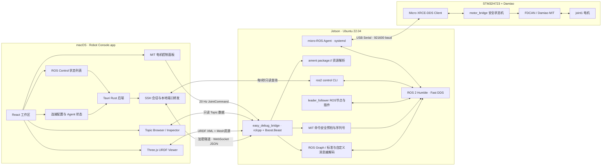
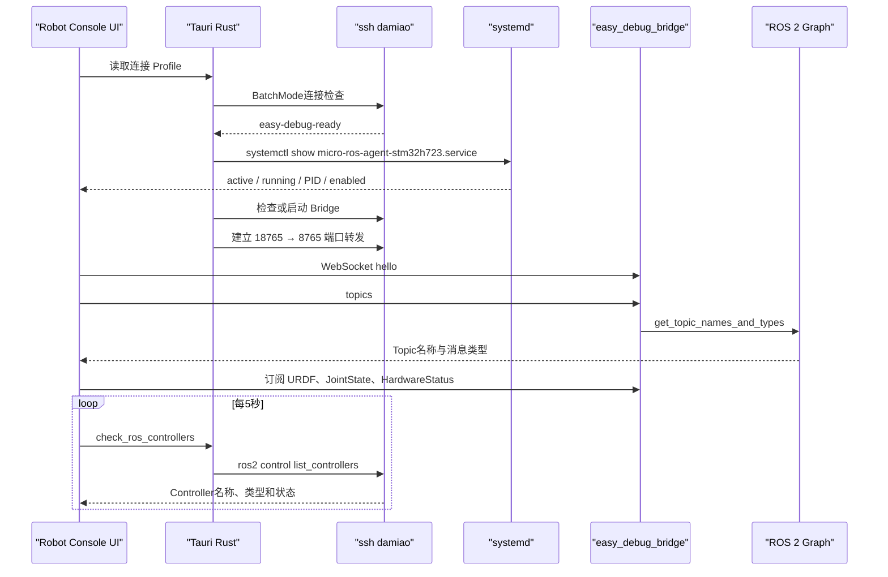
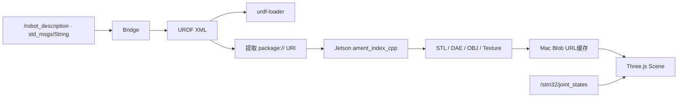
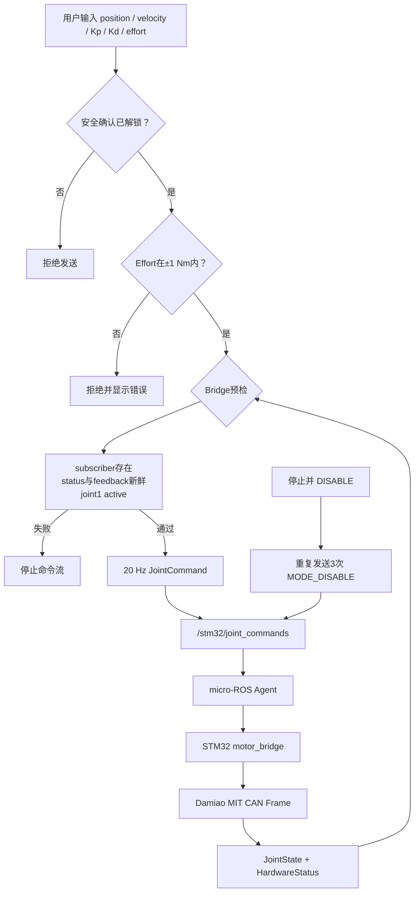

# Robot Console 上位机架构

Robot Console 是运行在 macOS Apple Silicon 上的 ROS 2 Humble 调试与受控操作上位机。Mac 不安装 ROS 2，也不直接加入 DDS 网络；Topic 数据和控制命令由 Jetson Bridge 转发，ROS Control 状态通过 Jetson 上的 `ros2 control` CLI 只读查询。

> [!info] 当前部署
> - Mac：Tauri v2 + Rust + React + TypeScript + Three.js
> - Jetson：Ubuntu 22.04 + ROS 2 Humble + Fast DDS
> - Bridge：`127.0.0.1:8765`
> - Mac本地转发：`127.0.0.1:18765`
> - SSH配置：`damiao`
> - micro-ROS Agent：`micro-ros-agent-stm32h723.service`

## 总体架构

## 连接时序

## 主要数据流

| 方向 | Topic / 接口 | 类型 | 用途 |
|---|---|---|---|
| ROS → UI | `/robot_description` | `std_msgs/msg/String` | URDF XML |
| ROS → UI | `/stm32/joint_states` | `sensor_msgs/msg/JointState` | 三维模型驱动与实时反馈 |
| ROS → UI | `/stm32/status` | `microros_stm32h723_bridge/msg/HardwareStatus` | 模式、序列号、active mask、故障码 |
| UI → ROS | `/stm32/joint_commands` | `microros_stm32h723_bridge/msg/JointCommand` | MIT 电机控制命令 |
| UI ↔ Bridge | WebSocket JSON | Easy Debug Protocol v0.1 | Topic发现、订阅、资源及命令 |
| ROS → UI | `/controller_manager/list_controllers` | ROS Control service / CLI | 已加载 Controller 的名称、类型和状态 |
| Bridge → UI | `package://...` | STL / DAE / OBJ / Texture | URDF网格与材质资源 |

XRCE-DDS 设备通过 micro-ROS Agent 映射到 Fast DDS graph，上位机不需要单独识别 XRCE实体。相关底层拓扑参见 [[设备拓扑与通信]]。

## URDF 渲染链路

DAE中的相对纹理路径会先在 Jetson解析并传输，再替换为本地 Blob URL。Bridge 对资源路径执行 canonicalize，并拒绝越过 package目录的请求。

## MIT 电机控制链路

### `JointCommand.mode`

| 值 | 模式 | 当前固件行为 |
|---:|---|---|
| `0` | HOLD | 锁存当前反馈位置，使用 Kp/Kd 保持 |
| `1` | TRACK | MIT跟踪 position、velocity、Kp、Kd、effort |
| `2` | RETURN | MIT跟踪返回目标，通常为 `0 rad` |
| `3` | DISABLE | 撤销电机使能，所有命令通道写零 |

> [!danger] 控制边界
> 当前固件仅激活 joint1，`active_joint_mask = 0x01`。Bridge 强制把 joint2–joint7 的 position、velocity、Kp、Kd和effort全部写零，避免触发 `MOTOR_FAULT_INACTIVE_JOINT_COMMAND`。

### 上位机限幅

| 参数 | 上位机与 Bridge 限制 |
|---|---:|
| Position | 不限制；由 STM32 固件最终校验 |
| Velocity | 不限制；由 STM32 固件最终校验 |
| Kp | 不限制；由 STM32 固件最终校验 |
| Kd | 不限制；由 STM32 固件最终校验 |
| Effort | `±1 Nm` |

停止20 Hz命令流后，STM32固件在 `100 ms` 后进入 HOLD，在 `500 ms` 后进入 DISABLE。界面“停止并 DISABLE”不要求解锁；连接在控制期间主动断开时也会先请求 DISABLE。

## 故障与降级

> [!warning] Fail-safe行为
> - SSH或WebSocket断开：命令流停止，由固件超时进入 HOLD → DISABLE。
> - micro-ROS Agent未运行：顶部状态标识变红，Bridge因无 command subscriber拒绝控制。
> - status或joint feedback超过1秒：Bridge拒绝非 DISABLE 指令。
> - `fault_code != 0`：UI显示 fault 名称和中文详情，STM32固件决定是否接受命令。
> - controller manager不可用：ROS Control列表显示离线，Topic、URDF和电机控制界面继续工作。
> - URDF mesh丢失：仅影响对应 visual，Topic检查和控制链路仍可使用。

## 代码位置

| 模块 | 路径 |
|---|---|
| React工作区 | `/Users/jialiang/Project/easy_debug/src/App.tsx` |
| MIT控制面板 | `/Users/jialiang/Project/easy_debug/src/MotorControl.tsx` |
| URDF渲染 | `/Users/jialiang/Project/easy_debug/src/UrdfViewer.tsx` |
| Tauri SSH后端 | `/Users/jialiang/Project/easy_debug/src-tauri/src/lib.rs` |
| ROS Bridge | `/Users/jialiang/Project/easy_debug/bridge/easy_debug_bridge/src/bridge_node.cpp` |
| ROS消息定义 | `/Users/jialiang/Project/leader_follower/src/plugin/microros_stm32h723_bridge/msg` |
| STM32控制状态机 | `/Users/jialiang/Project/rebotarm_executor/User/motor_bridge.c` |

## 后续演进

- [ ] 将 Bridge改为独立 systemd用户服务并增加版本检查
- [ ] Topic数值曲线和字段选择器
- [ ] TF树与坐标系显示
- [ ] 多关节 active mask控制
- [ ] Bridge二进制自动部署与升级
- [ ] 网格资源流式传输和磁盘缓存
