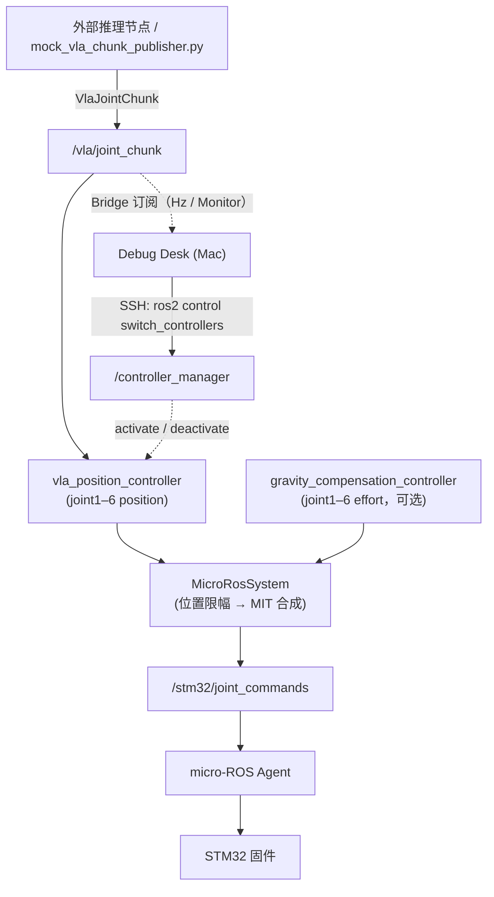

# VLA 使用指南（Scheme B）

本文说明如何在 **Rebotarm Debug Desk** 中启停 VLA（Vision-Language-Action）控制、用 mock 发布器做冒烟测试、编写自己的推理节点，以及排查常见问题。控制器与消息定义在 ros2-stack 中，控制器与参数的权威参考见 stack 文档 [VLA 使用（vla-usage.md）](https://github.com/phamstered/rebotarm-ros2-stack/blob/main/docs/vla-usage.md)（stack PR #18）和 [VLA integration (scheme B)](https://github.com/phamstered/rebotarm-ros2-stack/blob/main/docs/vla-integration.md)；固件侧超时、HOLD、fault 与 effort 限制见 executor 文档 [docs/vla.md](https://github.com/phamstered/rebotarm-executor/blob/main/docs/vla.md)（executor PR #9）。

::: tip 本文依据
内容按 desk `main`（含 #94、#97/#100）与 `rebotarm-ros2-stack` `main`（含 #15、#16）的代码整理：desk `src/vlaLogic.ts`、`src/statusLogic.ts`、`src/App.tsx`、`src-tauri/src/lib.rs`、Bridge `bridge_node.cpp`；stack `vla_position_controller.cpp`、`VlaJointChunk.msg`、`arm_controllers.yaml`、`stm32h723_arm.launch.py`、`mock_vla_chunk_publisher.py`。标注「未验证」的内容仅来自代码阅读，未在真机上确认。
:::

## 1. 概览：Scheme B

- **控制器**：`vla_position_controller`（插件 `microros_stm32h723_bridge/VlaPositionController`），在 ros2_control 中运行，只声明 `joint1`–`joint6` 的 **position** 命令接口。
- **并行**：可与 `gravity_compensation_controller`（只声明 **effort** 接口）同时 active，重力补偿照常生效。
- **输入**：外部推理节点向 **`/vla/joint_chunk`** 发布 `microros_stm32h723_bridge/msg/VlaJointChunk`。
- **动作空间**：关节角 **q**（rad），每条消息是一组 6 维目标位置；没有末端位姿 / IK 层。
- **互斥**：与 `arm_teleop_controller`、`arm_trajectory_controller` 抢同一组 position 接口，不能同时 active，切换走 `ros2 control switch_controllers`。
- **不直写 `/stm32/joint_commands`**：VLA 指令经 `MicroRosSystem` 合成 MIT 命令后才到 STM32。Desk 的 VLA 功能本身也不向该 Topic 写 VLA 数据。
- 固件不需要改动。

## 2. 架构



> 站点未启用 Mermaid 渲染插件时，上面的代码块按源码显示；可复制到 [mermaid.live](https://mermaid.live) 查看。

## 3. 前置条件

| 项 | 要求 |
|----|------|
| ros2-stack 版本 | `main` 含 PR #15（`VlaPositionController` + `VlaJointChunk`）与 PR #16（bring-up 时以 inactive 加载 `vla_position_controller`），两者均已合并 |
| 控制器已加载 | `stm32h723_arm.launch.py` 在 **normal control** 条件下执行 `spawner vla_position_controller --inactive`。当 `position_controller:=none` 且开启重力或 Joint4 标定（例如 `start_arm_teleop.sh --mode=gravity` / `--mode=calibration`）时**不会**加载 VLA 控制器 |
| 消息包已编译并 source | Jetson 上 `colcon build` 过 `microros_stm32h723_bridge`（含 `VlaJointChunk`），推理节点与 Bridge 的环境都 source 了该 `install/setup.bash` |
| 工作区路径 | Desk 远端命令默认在 `$HOME/Project/rebotarm-ros2-stack` 找工作区，可用环境变量 `LEADER_FOLLOWER_WS` 覆盖（优先级：`LEADER_FOLLOWER_WS` → Profile 的 ROS setup 脚本所在工作区 → `$HOME/Project/rebotarm-ros2-stack` → 旧 `$HOME/Project/leader_follower`）|
| 推荐启动方式 | `start_arm_teleop.sh` 没有 VLA 选项。teleop 与 trajectory 两种启动都会以 inactive 加载 VLA，只有 Gravity-ID（`position_controller:=none`）与 `state_only` 不加载。**推荐**组合：在 Jetson 终端运行 `./scripts/start_arm_teleop.sh --position-controller=trajectory --gravity=true`，然后在 Desk Status 启动 VLA。原因：没有重力补偿时，机械臂在 VLA 控制下会下垂 |
| Desk 连接 | SSH 与 Bridge 已连接；JointState 已就绪（「启动 VLA」按钮的门控条件是 SSH 正常 **且** ROS 就绪）|

在 Jetson 上可以先确认控制器状态：

```bash
ros2 control list_controllers
# 期望看到 vla_position_controller ... inactive
```

## 4. 在 Desk 中使用

### 4.1 Status → VLA 卡片

卡片内容（来自 `buildStatusCards`）：

| 状态 | 卡片显示 |
|------|----------|
| SSH 未连接 | 「SSH 未就绪」 |
| 尚未查询到控制器 | 「检查中…」 |
| Controller Manager 不可用 | 失败色「Controller Manager 离线」，原因为 `check_ros_controllers` 返回的信息 |
| `vla_position_controller` active 且收到 chunk | 成功色「运行中 · xx Hz」，详情 `vla_position_controller · /vla/joint_chunk xx Hz` |
| active 但 Desk 没采样到 chunk | 成功色「控制器 active」，详情「active · 等待 /vla/joint_chunk」 |
| 未激活 | 警告色「未运行」，原因「vla_position_controller 未激活（可通过一键启动；与 arm_teleop / arm_trajectory 互斥）」 |

信息行：**控制器**（active / inactive）、**名称**、**Chunk Topic**（有 Hz 时显示频率）、**Gravity**（`gravity_compensation_controller` 是否 active；未激活时为警告色）。

### 4.2 启动 VLA

点击卡片上的「启动 VLA」或顶部「一键 VLA」。Desk 依次执行：

1. **HOLD**：经 Bridge 发送 mode 0（HOLD）的 `joint_command`，位置取当前 JointState。若未确认，提示「HOLD 请求未确认，仍继续模式切换」并继续。
2. **停止 Teleop/Trajectory 进程**：`start_arm_mode stop`，按 `~/.cache/robot-console/arm-teleop.pid` / `arm-trajectory.pid` 停掉 Desk 一键拉起的进程组。
3. **重新查询控制器**，计算切换集合：
   - activate：`vla_position_controller`；若 `gravity_compensation_controller` 已加载但未 active，一并 activate；
   - deactivate：当前 active 的 `arm_teleop_controller` / `arm_trajectory_controller`。
4. 经 SSH 执行 `ros2 control switch_controllers --activate … --deactivate … --strict --spin-time 1 -c /controller_manager`（带 `timeout 10`，并使用 Profile 的 `ROS_DOMAIN_ID`）。`--strict` 表示任一控制器失败则整体失败。
5. 刷新控制器与运行态；Status 顶部提示显示命令最后一行输出或「已激活 vla_position_controller」。

激活瞬间控制器以**当前关节位置**作为目标并保持，直到收到第一条 chunk。

VLA active 时，Teleop / Trajectory 的「重新拉起」与一键按钮被禁用，提示「先停止 VLA」。

::: info Desk 一键能否得到推荐组合
Desk 一键 Teleop 运行 `--position-controller=teleop --gravity=true --gripper=true --clean=true --start-leader=true`，一键 Trajectory 运行 `--position-controller=trajectory`（不带 `--gravity`）。两者都没有完全对应推荐的 `trajectory + gravity=true`。不过在这两种模式下 VLA 都会以 inactive 加载，gravity 也已加载（active 或 inactive），而「启动 VLA」会顺带激活未 active 的 gravity，所以控制器组合本身能凑齐。问题在于下面这条警告。
:::

::: danger ⚠️ 已知问题（未在真机验证）：Desk 一键 Teleop/Trajectory 后不要点「启动 VLA」
**直到修复前，如果当前 ros2_control 是由 Desk 一键 Teleop / Trajectory 的脚本拉起的，不要使用「启动 VLA」/「一键 VLA」。**

原因（来自代码阅读）：Desk 一键 Teleop / Trajectory 运行的 `start_arm_teleop.sh` 在 ros2_control 未运行时会**自己**启动 `stm32h723_arm.launch.py`，脚本退出时会连同 ros2_control 一起清理。「启动 VLA」第 2 步（`start_arm_mode stop`）会停掉这个脚本，而停止方式与脚本的清理流程存在竞争：

- **Desk 的停止**：对脚本**进程组**发 `kill -INT -$pid`，约 5 s 后脚本仍在则发 `kill -TERM -$pid`。
- **ros2_control 不直接收到这些信号**：它由脚本用 `setsid` 启动，处于独立的 session / 进程组，只有脚本的 cleanup 会去停它。
- **脚本 cleanup**（收到 SIGINT 后执行，第一行就移除了 trap，所以之后的 SIGTERM 会直接中断它）：
  1. 调用 `/microros_stm32h723_hardware/safe_stop`（`timeout 8`），硬件用约 3 s 把各关节**驱动回零位**，各关节都在零位 0.03 以内后进入 DISABLE；
  2. 等待 `/stm32/status` 的 mode 变为 3（DISABLE），最多 10 s；
  3. 然后才停止 ros2_control。

关键点（代码阅读，未在真机验证）：`safe_stop` 在 `MicroRosSystem` 里是一个**锁存标志**，只有硬件 `on_activate` 才会清除。服务一旦被调用，即使脚本被杀，只要 ros2_control 还活着，`write()` 就会继续执行回零；回零期间位置目标被覆盖，VLA 的目标不起作用。之后的表现取决于启动时使用的**增益文件**。

权威的排障说明以 stack 文档为准：[vla-usage.md「与 rebotarm-debug-desk 配合」](https://github.com/phamstered/rebotarm-ros2-stack/blob/33963c7/docs/vla-usage.md#与-rebotarm-debug-desk-配合)（stack [PR #21](https://github.com/phamstered/rebotarm-ros2-stack/pull/21)，尚未合并）。

**结果 A：cleanup 完整执行**

机械臂**意外运动回零位** → cleanup 停止 ros2_control。Controller Manager 退出，第 4 步 `switch_controllers` 失败。退出时固件若不在 DISABLE，按结果 B2 处理。

**结果 B1：cleanup 被 SIGTERM 打断，但 ros2_control 仍在运行**

机械臂**意外运动回零位**。`switch_controllers` **报告成功**，Status 显示 VLA active，但机械臂**不跟随 VLA**。`/stm32/status` 取决于增益文件：

- **B1a：RETURN kp 全为 0 的增益**（`gravity_mit_gains.yaml`，仅 `position_controller=none` 的重力 / 标定启动使用）：直接进入 DISABLE，之后 ros2_control 用同一个序列号反复发 DISABLE 帧，固件按过期序列号拒收。`/stm32/status` 稳定显示 **`mode=3`、`fault_code=4`**，不会出现 fault 11。
- **B1b：RETURN kp 非 0 的增益**（`arm_mit_gains.yaml` / `arm_gripper_mit_gains.yaml`，即 teleop / trajectory 启动、也就是 VLA 路径的默认增益）：发出一帧 DISABLE 后，`write()` 发现模式不是 RETURN，会以新序列号**重新进入 RETURN**，于是机械臂**在零位附近被刚性保持**。`/stm32/status` 多数时间为 **`mode=2`、`fault_code=0`**，偶尔出现 `fault_code=4`。**疑似 stack `MicroRosSystem` 的 bug**，修复方案尚待确认。此状态下硬件 `inactive` 会被拒绝（`on_deactivate` 要求固件先确认 DISABLE），重启 ros2_control 则很可能锁存 fault 11（见 B2）。目前从代码看**没有可靠的恢复方法**，只能安全回零后重启 MCU，以 stack 修复和 stack 文档为准。

**结果 B2：ros2_control 在固件进入 DISABLE 之前退出**

例如 `safe_stop` 服务调用失败或被拒后 cleanup 直接停 ros2_control，或在 B1b 状态下重启 ros2_control。`/stm32/joint_commands` **停止发布**后：固件只有在 **TRACK 模式下**才会先在 100 ms 后切到 **HOLD**（effort 为 0、**没有重力补偿**，较重的关节可能下垂）；在 RETURN 模式下没有这一步。两种模式都会在 500 ms 后锁存 **fault 11**，之后所有新指令都被拒绝，必须先安全回零，再**重启 MCU/固件**才能恢复。

fault 11 与固件超时行为见 [rebotarm-executor docs/vla.md](https://github.com/phamstered/rebotarm-executor/blob/main/docs/vla.md)。

**替代做法**：在 Jetson 终端手动运行

```bash
./scripts/start_arm_teleop.sh --position-controller=trajectory --gravity=true
```

这样启动的进程不在 Desk 的 pid 文件（`~/.cache/robot-console/arm-*.pid`）中，Desk 的 stop 不会停掉它。之后再在 Desk Status 中启动 VLA。
:::

### 4.3 停止 VLA / 回到 HOLD

- **卡片「停止 VLA」**：先 HOLD，再 `switch_controllers --deactivate vla_position_controller`。gravity 不会被停用。
- **顶部「停止 Teleop/Trajectory/VLA」**：先 HOLD，再停 Teleop/Trajectory 进程组，然后尝试 deactivate `vla_position_controller`；如果 VLA 本来未加载导致失败，只提示错误并继续。
- 在 VLA active 时点 Teleop / Trajectory「重新拉起」，Desk 会先 HOLD、deactivate VLA，再启动对应模式。

控制器 deactivate 时把最后一次指令位置写回 position 接口。之后 position 接口不再有控制器写入，直到 Teleop/Trajectory 控制器被激活。

## 5. 用 mock 发布器快速测试

stack 自带 `mock_vla_chunk_publisher.py`，以正弦波发布 `VlaJointChunk`。在 Jetson 上运行：

```bash
cd ~/Project/rebotarm-ros2-stack   # 或你的 $LEADER_FOLLOWER_WS
source install/setup.bash
ros2 run microros_stm32h723_bridge mock_vla_chunk_publisher.py
```

可用参数（`--ros-args -p 名称:=值`）：

| 参数 | 默认 | 说明 |
|------|------|------|
| `topic` | `/vla/joint_chunk` | 发布 Topic |
| `publish_rate_hz` | `10.0` | 发布频率，必须 > 0 |
| `amplitude_rad` | `0.15` | 正弦幅值（rad） |
| `frequency_hz` | `0.1` | 正弦频率 |
| `timeout_sec` | `0.0` | 写入消息的 `timeout_sec`；`0` 表示使用控制器默认值 |
| `num_joints` | `6` | `positions` 长度，必须与控制器 `joints` 数量一致 |

例如降低幅值：

```bash
ros2 run microros_stm32h723_bridge mock_vla_chunk_publisher.py \
  --ros-args -p amplitude_rad:=0.05 -p publish_rate_hz:=20.0
```

::: danger mock 发的是绝对角
mock 的第 i 个关节目标为 `amplitude_rad * sin(2π·frequency_hz·t + 0.35·i)`，即**围绕 0 rad 的绝对角**，不是相对当前姿态的偏移。若机械臂当前不在零位附近，启动后会以最高 `max_delta_per_sec`（默认 1 rad/s）的速度向零位附近移动。测试前请确认零位附近的工作空间无障碍。另外 joint2/joint3 的位置上限是 `0.0`，正半周会被 `MicroRosSystem` 限幅。

只想验证「保持」行为时，可以只激活 VLA、**不发布**任何 chunk：控制器激活后保持当前位置。
:::

::: warning 不要只发一条
`ros2 topic pub --once` 只发一条：受限速影响，机械臂只走约 0.2 rad（1.0 rad/s × 0.2 s 超时）就会因超时停住。推理节点必须**持续**发布。
:::

验证：Status VLA 卡片应显示「运行中 · ~10 Hz」（需要 Bridge 能解码，见[第 9 节](#_9-故障排查)）；也可在 Jetson 上运行 `ros2 topic hz /vla/joint_chunk`。

## 6. 编写自己的推理节点

### 6.1 消息与 Topic

`microros_stm32h723_bridge/msg/VlaJointChunk`：

```text
std_msgs/Header header
float32[] positions
float32 timeout_sec
```

| 字段 | 语义（按 `VlaPositionController` 实现） |
|------|------|
| `header` | 控制器**不读取**；超时按收到消息时控制器节点的时钟计算，而不是 `header.stamp`。建议照常填写 stamp / frame_id，方便录包和调试 |
| `positions` | 目标关节角（rad），长度必须等于控制器 `joints` 数量（默认 6）。长度不符或含 NaN/Inf 时**整条丢弃**并节流告警，控制器保持原目标 |
| `timeout_sec` | `> 0`（且有限）时，覆盖本条消息之后的超时时间；`<= 0` 时使用参数 `command_timeout_sec`（默认 0.2 s）。覆盖值一直有效，直到下一条消息。代码中**没有上限** |

- Topic：`/vla/joint_chunk`（控制器参数 `chunk_topic`），控制器订阅使用 `rclcpp::SystemDefaultsQoS()`；mock 发布器使用 depth 10 的默认 QoS，自写节点照此即可。
- 关节顺序：`positions[i]` 对应控制器参数 `joints[i]`，默认为 `[joint1, joint2, joint3, joint4, joint5, joint6]`，与发布顺序无关（消息中没有关节名）。
- 一条消息就是一个目标向量。如果模型输出多步 action chunk，需要由发布方按时间逐步发布，消息本身不带时间轴。
- 夹爪不在该控制器内（只声明 joint1–6）。

### 6.2 频率与超时

- 控制器每个控制周期把内部指令向最新目标靠近，每关节步长不超过 `max_delta_per_sec × dt`（`dt` 截到 ≤ 0.1 s）。
- 距最近一次收到合法消息超过有效超时（`timeout_sec` 或 `command_timeout_sec`）后，控制器**保持最后一次指令位置**（而不是最后的目标），首次触发时输出 WARN 日志 `VlaJointChunk timed out …`；新消息到来后恢复跟踪。
- 默认超时 0.2 s，发布频率应明显高于 5 Hz；mock 默认 10 Hz。若推理较慢，可以在消息里设更大的 `timeout_sec`，但超时越长，推理卡死后机械臂停住所需时间也越长。

### 6.3 运行位置

- **在 Jetson 上运行**：与 ros2_control 处于同一主机，source 同一个 stack `install/setup.bash` 即可。
- **在其它机器上运行**：未在 stack 文档中说明，以下仅为 ROS 2 通用要求：该机器需要能生成并 import `microros_stm32h723_bridge/msg/VlaJointChunk`（编译该包或至少它的消息部分），并与 Jetson 处于同一 DDS 网络、使用相同的 `ROS_DOMAIN_ID`（Desk 使用连接 Profile 中的 Domain）。跨机网络与 QoS 表现**未验证**。

最小 Python 发布示例：

```python
import rclpy
from rclpy.node import Node
from microros_stm32h723_bridge.msg import VlaJointChunk

class MyPolicy(Node):
    def __init__(self):
        super().__init__('my_vla_policy')
        self.pub = self.create_publisher(VlaJointChunk, '/vla/joint_chunk', 10)
        self.create_timer(0.05, self.tick)  # 20 Hz

    def tick(self):
        q = self.infer()  # 6 个关节角（rad），顺序 joint1..joint6
        msg = VlaJointChunk()
        msg.header.stamp = self.get_clock().now().to_msg()
        msg.positions = [float(v) for v in q]
        msg.timeout_sec = 0.0  # 使用控制器默认 0.2 s
        self.pub.publish(msg)
```

## 7. Monitor：VLA 仪表盘

Monitor 工具栏的 **`+VLA`** 按钮新建名为「VLA Joint Chunk」的仪表盘，含 6 个 Panel，分别绘制 `/vla/joint_chunk` 的 `positions[0]` … `positions[5]`。数据来自 Desk 连接时对该 Topic 的 Bridge 订阅（类型 `microros_stm32h723_bridge/msg/VlaJointChunk`）。曲线显示的是**推理目标**，不是实际关节位置；实际位置可在其它 Panel 中加 JointState `position[i]` 对比。

## 8. 安全说明

- **切换前 HOLD**：Desk 启动/停止 VLA 前都会先发 HOLD；未确认时只提示并继续，不会中止切换。
- **超时保持**：推理断流超过超时后控制器保持最后一次发出的位置。stack 文档要求：推理 stale 时上层 / 固件应保持 **HOLD**。控制器本身不会切换固件模式。
- **固件侧保护**：固件有独立的指令超时 → HOLD（仅 TRACK 模式）、超时 fault 锁存、单帧 effort 上限，HOLD 下不做重力补偿，具体数值以 [executor docs/vla.md](https://github.com/phamstered/rebotarm-executor/blob/main/docs/vla.md) 为准。
- **限速**：每关节最大 `max_delta_per_sec`（默认 1.0 rad/s，`arm_controllers.yaml`）。
- **限位**：`VlaPositionController` 本身**不**做位置限幅；位置限幅在 `MicroRosSystem` 中按 URDF `command_interface` 的 min/max 执行（`rebotarm.arm.micro_ros.xacro`：joint1 ±2.8，joint2/joint3 [-3.14, 0.0]，joint4 [-1.87, 1.57]，joint5 ±1.57，joint6 ±3.14 rad）。effort 由 `MicroRosSystem` 按 gains 文件 `effort_limits` 限幅。
- **非法输入**：长度不符或含 NaN/Inf 的消息被丢弃；激活时若状态位置非有限，激活失败。
- **Desk Effort 限制**：MIT 电机控制页的 Effort 输入限制在 [-1, 1]，Bridge 也会拒绝 `|effort| > 1` 的 `joint_command`。这只作用于 Desk 手动指令，**不**作用于 VLA 路径。
- 首次使用建议降低 `max_delta_per_sec` 和 mock 幅值，并保持急停可用。

## 9. 故障排查

| 现象 | 可能原因 | 处理 |
|------|----------|------|
| 卡片「未运行」，启动报找不到 `vla_position_controller` | stack 未含 PR #16，或以 `position_controller:=none` + 重力/标定模式启动，VLA 未被加载 | 更新 stack 并重新编译；使用 normal control 启动；`ros2 control list_controllers` 确认 |
| 「Controller Manager 离线」/ 切换超时 | `ros2_control_node` 未运行 | 在 Jetson 独立启动 ros2_control 后重试 |
| ⚠️ 点「启动 VLA」后机械臂意外回零，Controller Manager 消失 | 结果 A：Desk 停掉了自己一键拉起的 Teleop/Trajectory 脚本，脚本 cleanup 先 safe stop 再停 ros2_control（见 [4.2 的危险提示](#_4-2-启动-vla)；代码阅读，未在真机验证）| 先检查 `/stm32/status`：有 fault 11 按最后一行处理。之后在 Jetson 终端手动运行 `start_arm_teleop.sh --position-controller=trajectory --gravity=true`，再从 Desk 启动 VLA |
| ⚠️ `/stm32/status` 稳定为 `mode=3`、`fault_code=4`；VLA active 但不动 | 结果 B1a：`safe_stop` 已执行，ros2_control 仍在运行，使用 RETURN kp=0 的增益 | **重启 MCU 没有用**。先 deactivate 控制器，再 `ros2 control set_hardware_component_state Stm32H723ArmSystem inactive` → `active`，然后重新激活控制器；或重启 ros2_control。具体命令见 [stack 文档](https://github.com/phamstered/rebotarm-ros2-stack/blob/33963c7/docs/vla-usage.md#与-rebotarm-debug-desk-配合) |
| ⚠️ `/stm32/status` 多为 `mode=2`（偶尔 `fault_code=4`），机械臂在零位附近刚性保持不动 | 结果 B1b：`safe_stop` 已执行，ros2_control 仍在运行，使用 RETURN kp≠0 的增益（VLA 默认）。疑似 stack bug（[PR #21](https://github.com/phamstered/rebotarm-ros2-stack/pull/21)）| 目前从代码看没有可靠的恢复方法：硬件 `inactive` 会被拒绝，重启 ros2_control 很可能锁存 fault 11。只能安全回零 + 重启 MCU，并以 [stack 文档](https://github.com/phamstered/rebotarm-ros2-stack/blob/33963c7/docs/vla-usage.md#与-rebotarm-debug-desk-配合) / stack 修复为准 |
| ⚠️ `/stm32/status` 报 `fault_code=11` | 结果 B2：ros2_control 在固件 DISABLE 前退出（TRACK 下先 100 ms 进 HOLD、无重力补偿；RETURN 下没有这一步）→ 500 ms 锁存 fault 11 | 先安全回零，再重启 MCU/固件（见 [executor docs/vla.md](https://github.com/phamstered/rebotarm-executor/blob/main/docs/vla.md)），之后按推荐方式启动 |
| 「Controller 批量切换失败」 | Desk 只 deactivate 当前处于 active 的 teleop/trajectory，正常情况下 Humble 上的 `--strict` 切换不会因此失败。若仍失败，通常是任一控制器无法切换：teleop/trajectory 未被停用、gravity 状态异常、控制器名不一致等 | 查看提示中的 `switch_controllers` 输出；手动 `ros2 control list_controllers` 检查 |
| 卡片「控制器 active · 等待 /vla/joint_chunk」 | 推理节点未发布；Topic 名不一致；`ROS_DOMAIN_ID` 不一致；或 Bridge 无法解码 | Jetson 上 `ros2 topic hz /vla/joint_chunk`；有数据则多半是 Bridge 解码问题（下一行）|
| 有数据但 Hz / Monitor 曲线为空 | Bridge 没有 `VlaJointChunk` 的内置解码器，走运行时 introspection；若 Bridge 运行环境 source 的 stack 不含该消息，订阅报「无法加载消息类型」。Desk 只在连接时订阅一次 | 确保 Bridge 运行环境 source 了含 `VlaJointChunk` 的 stack；重新部署 / 重启 Bridge 后**重新连接** Desk。Status 启停不依赖此项 |
| 机械臂不动，日志 `Ignoring VlaJointChunk: expected 6 positions` | `positions` 长度不对 | 发 6 个值，顺序 joint1..joint6 |
| 机械臂停住，日志 `VlaJointChunk timed out` | 发布频率低于超时要求或推理卡住 | 提高频率，或在消息中设置合适的 `timeout_sec` |
| 只动一下就停 | 只发了一条（如 `--once`），超时后保持 | 持续发布 |
| 某关节只走到一半就停 | 被 URDF 限位截断（如 joint2/joint3 上限 0.0）| 检查目标是否在限位内 |

## 10. 与数据采集的关系

[数据采集（LeRobot v3）](./features#数据采集-lerobot-v3) 页基于 Teleop 录制 LeRobot 数据集，可用于训练策略。采集器不发布机器人指令、不切换控制器。训练好的策略按第 6 节发布 `/vla/joint_chunk` 即可接入本页流程。

## 相关链接

- 固件：[rebotarm-executor docs/vla.md](https://github.com/phamstered/rebotarm-executor/blob/main/docs/vla.md)

- stack：[docs/vla-usage.md](https://github.com/phamstered/rebotarm-ros2-stack/blob/main/docs/vla-usage.md)、[docs/vla-integration.md](https://github.com/phamstered/rebotarm-ros2-stack/blob/main/docs/vla-integration.md)、[controllers.md](https://github.com/phamstered/rebotarm-ros2-stack/blob/main/docs/controllers.md)
- desk：[功能概览 · Status](./features#status-状态总览)、[基本功能与测试覆盖](./basic-features)、[Monitor](./features#monitor)
